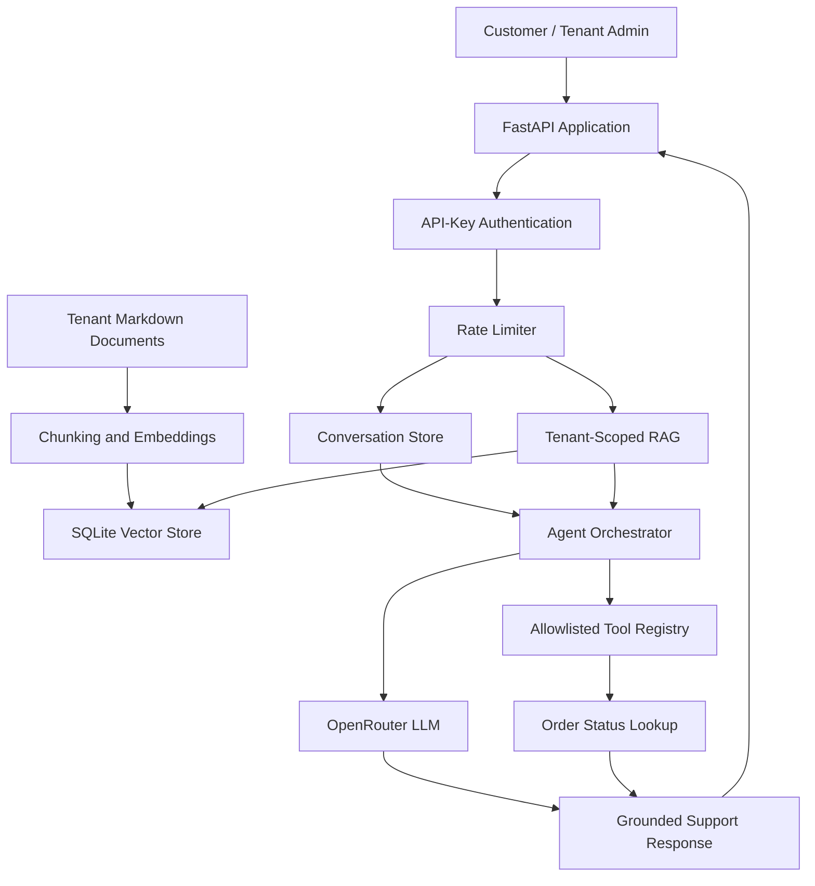

# Agentic Customer Support System

A Python-based agentic customer-support platform built with FastAPI, OpenRouter, tool calling, and Retrieval-Augmented Generation (RAG).

The system retrieves relevant knowledge-base information, generates evidence-grounded support responses, executes an allowlisted order-status tool, and maintains tenant-scoped conversations and knowledge bases.

It includes API-key authentication, role-based authorization, persistent storage, a lightweight browser dashboard, retrieval evaluation, and automated tests.

> **Project status:** Working local prototype — not production-ready. The order lookup currently uses in-memory demo data. Live support requests have an unresolved HTTP 502 provider error. Docker deployment has not yet been verified.

## Features

- **Agentic support workflow:** Combines LLM reasoning, knowledge retrieval, and controlled tool execution.
- **Grounded responses:** Retrieves relevant knowledge-base chunks and requires exact evidence sentences with source citations.
- **Tool calling:** Uses OpenRouter and Pydantic-validated tool inputs, with an allowlisted dispatcher and a bounded three-iteration agent loop.
- **Retrieval-Augmented Generation:** Markdown chunking, FastEmbed embeddings, cosine-similarity search, and SQLite vector storage.
- **Tenant-isolated knowledge bases:** Stores tenant documents and vector indexes separately.
- **Conversation persistence:** Saves conversation history with tenant and customer ownership restrictions.
- **Authentication:** API keys are stored as SHA-256 digests, with customer, tenant-admin, and platform-admin roles.
- **Knowledge-base management:** Authorized tenant administrators can create, update, list, and delete Markdown documents.
- **Usage tracking:** Returns provider-reported token usage and cost information when available.
- **Rate limiting:** Supports persistent SQLite rate limiting and an optional Redis-backed limiter.
- **Browser dashboard:** Provides a lightweight interface for support chats, conversation browsing, and knowledge-base management.
- **Automated testing:** Includes unit, integration, security, and RAG evaluation tests.

## Architecture



Retrieved knowledge-base content is treated as untrusted evidence. The system instructs the model not to follow instructions contained in retrieved documents.

This is a defense-in-depth measure, not a guarantee against prompt injection.

## Repository Structure

```text
agentic-customer-support/
│
├── knowledge_base/
│   ├── faqs/
│   │   └── general.md
│   └── policies/
│       ├── returns.md
│       └── shipping.md
│
├── scripts/
│   ├── __init__.py
│   ├── audit_vector_database.py
│   ├── evaluate_retrieval.py
│   ├── ingest_knowledge_base.py
│   └── test_real_retrieval.py
│
├── src/
│   ├── __init__.py
│   ├── agent.py
│   ├── app.py
│   ├── conversations.py
│   ├── llm_client.py
│   ├── rate_limiter.py
│   ├── security.py
│   ├── tenant_services.py
│   │
│   ├── rag/
│   │   ├── __init__.py
│   │   ├── chunking.py
│   │   ├── context_builder.py
│   │   ├── embeddings.py
│   │   ├── evaluation.py
│   │   ├── ingestion.py
│   │   ├── retrieval.py
│   │   ├── similarity.py
│   │   └── vector_store.py
│   │
│   ├── schemas/
│   │   └── support.py
│   │
│   └── tools/
│       ├── order_tools.py
│       └── registry.py
│
├── tests/
│   ├── rag_golden_cases.json
│   ├── test_agent.py
│   ├── test_app.py
│   ├── test_chunking.py
│   ├── test_context_builder.py
│   ├── test_conversations.py
│   ├── test_embeddings.py
│   ├── test_ingestion.py
│   ├── test_llm_client.py
│   ├── test_order_tools.py
│   ├── test_rag_evaluation.py
│   ├── test_rate_limiter.py
│   ├── test_retrieval.py
│   ├── test_security.py
│   ├── test_similarity.py
│   ├── test_tenant_services.py
│   ├── test_tool_registry.py
│   └── test_vector_store.py
│
├── .dockerignore
├── .env.example
├── .gitignore
├── Dockerfile
├── README.md
├── pyproject.toml
└── uv.lock
```

**Runtime data is intentionally excluded from Git.**

The application creates databases and tenant-specific knowledge-base data under its configured data directories. These may include API-key, conversation, rate-limit, and vector-store databases.

Never commit `.env`, API keys, customer information, or runtime databases.

## Technology Stack

| Area | Technology |
|---|---|
| Language | Python 3.12+ |
| API framework | FastAPI |
| LLM provider | OpenRouter |
| Model configuration | Environment variables |
| Agent architecture | Bounded tool-calling loop |
| Input validation | Pydantic |
| Embeddings | FastEmbed |
| Embedding model | BAAI/bge-small-en-v1.5 |
| Vector storage | SQLite |
| Similarity search | Cosine similarity |
| Conversation persistence | SQLite |
| Rate limiting | SQLite / optional Redis |
| Testing | pytest |
| Dependency management | uv |
| Containerization | Docker |

## Requirements

- Python 3.12 or newer
- [uv](https://docs.astral.sh/uv/)
- OpenRouter API key for live LLM requests
- A configured OpenRouter model

## Installation

Clone the repository:

```bash
git clone https://github.com/ali3dev/agentic-customer-support.git
cd agentic-customer-support
```

Install dependencies:

```bash
uv sync
```

Create your local environment file:

**Windows PowerShell**

```powershell
Copy-Item .env.example .env
```

**Linux / macOS**

```bash
cp .env.example .env
```

Configure the following variables in `.env`:

```env
OPENROUTER_API_KEY=your_openrouter_api_key
OPENROUTER_MODEL=anthropic/claude-sonnet-4.6
```

Use the actual variable names and additional settings documented in `.env.example`. Never publish your real credentials.

## API-Key Configuration

The application requires at least one `platform_admin` API key at startup.

Generate a secure random key:

```bash
uv run python -c "import secrets; print(secrets.token_urlsafe(32))"
```

Configure your API keys in `.env` using the application's JSON configuration:

```env
AGENTIC_API_KEYS_JSON='{"YOUR_PLATFORM_ADMIN_KEY":{"tenant_id":"platform","role":"platform_admin"},"YOUR_CUSTOMER_KEY":{"tenant_id":"tenant-demo","role":"customer","customer_id":"customer-demo"}}'
```

Replace both example keys with independently generated secrets.

Supported roles:

- `customer`
- `tenant_admin`
- `platform_admin`

Customer keys require a non-empty `customer_id`.

The application stores API-key digests rather than the original keys. Environment-configured keys removed from `.env` are revoked on restart.

Do not expose API keys in browser JavaScript, public repositories, or client-side applications.

## Run the Application

Start the FastAPI server:

```bash
uv run uvicorn src.app:app --host 127.0.0.1 --port 8000
```

Open the dashboard:

[http://127.0.0.1:8000/dashboard](http://127.0.0.1:8000/dashboard)

Health endpoint:

[http://127.0.0.1:8000/health](http://127.0.0.1:8000/health)

The health endpoint is unauthenticated. Application and administrative API endpoints require an `X-API-Key` header.

## Main API Endpoints

| Method | Endpoint | Access | Purpose |
|---|---|---|---|
| POST | `/api/v1/chat` | Configured tenant roles | Send a chat message |
| POST | `/api/v1/support` | Configured tenant roles | Get a support response with cited sources |
| GET | `/api/v1/conversations` | Tenant roles | List accessible conversations |
| GET | `/api/v1/conversations/{conversation_id}` | Tenant roles | Read a conversation |
| DELETE | `/api/v1/conversations/{conversation_id}` | Tenant roles | Delete an accessible conversation |
| GET | `/api/v1/knowledge-base` | Tenant / platform admin | List knowledge-base documents |
| PUT | `/api/v1/knowledge-base/{document_name}` | Tenant / platform admin | Create or update a document |
| DELETE | `/api/v1/knowledge-base/{document_name}` | Tenant / platform admin | Delete a document |
| GET | `/api/v1/admin/usage` | Tenant / platform admin | View tenant usage |
| `/api/v1/admin/tenants...` | Platform admin | Manage tenants and keys |

Chat requests accept a non-empty message up to 4,000 characters and an optional conversation UUID.

Responses include:

- `message`
- `sources`
- `usage`
- `conversation_id`

Provider-reported cost may be `null` when the provider does not return it.

## Tenant Management

Platform administrators can create tenants and issue tenant-admin or customer API keys.

Tenant administrators can manage their tenant's knowledge-base documents.

Customer API keys are bound to a tenant and authenticated customer ID. Customer conversation access is restricted to conversations owned by that customer.

The server derives tenant and customer identity from authenticated credentials, rather than trusting client-supplied identity values.

## RAG Pipeline

The RAG pipeline consists of the following stages:

1. **Document ingestion:** Reads Markdown documents from the configured knowledge base.
2. **Chunking:** Splits documents into smaller heading-aware text chunks.
3. **Embedding generation:** Uses FastEmbed to generate vector representations.
4. **Vector storage:** Persists embeddings and metadata in SQLite.
5. **Retrieval:** Finds relevant chunks using cosine similarity.
6. **Context construction:** Builds a context containing retrieved evidence and source metadata.
7. **Grounded generation:** Supplies evidence to the agent for citation-aware response generation.

The default relevance threshold is `0.6`. Evaluate your own labeled questions before changing it for a different knowledge base.

## Run Tests

Run the automated test suite:

```bash
uv run pytest -q
```

The latest reported full-suite result was:

```text
191 passed
```

Tests use mocks and fakes for external services where appropriate. A live OpenRouter API key is not required for the mocked test suite.

## Run RAG Evaluation

Ingest the sample knowledge base:

```bash
uv run python -m scripts.ingest_knowledge_base
```

Run the retrieval evaluation:

```bash
uv run python -m scripts.evaluate_retrieval
```

The reported sample golden-set evaluation found all expected sources at `k=3` (recall at k = 1.0).

This is a small regression baseline, not a production-quality retrieval benchmark. Add representative, labeled customer questions before relying on evaluation scores.

Additional utility:

```bash
uv run python -m scripts.audit_vector_database
```

The real retrieval test script is:

```bash
uv run python -m scripts.test_real_retrieval
```

## Docker

Build the Docker image:

```bash
docker build -t agentic-customer-support .
```

Run the container:

```bash
docker run --rm -p 8000:8000 --env-file .env -v agentic-data:/app/data agentic-customer-support
```

The Dockerfile uses digest-pinned base images and runs the application as a non-root user.

The `/app/data` directory must use persistent storage. Configure TLS through a trusted reverse proxy before exposing the application outside a local development environment.

**Docker build and deployment have not yet been verified in the current environment.**

## Current Verification and Known Issues

| Area | Current status |
|---|---|
| FastAPI application | Local startup reported successful |
| Health endpoint | HTTP 200 reported |
| API-key authentication | Reported working |
| Conversation endpoints | Authenticated access reported working |
| Automated tests | 191 passed in the latest reported full run |
| RAG evaluation | 3/3 expected sources found at k=3 |
| Live support request | HTTP 502; provider failure not yet identified |
| Docker build | Not verified; Docker daemon unavailable |
| Production deployment | Not deployed |

The HTTP 502 response is handled by the application. Additional safe diagnostic logging was added to record the provider exception type and upstream status without logging sensitive provider content.

The actual upstream failure remains unresolved. Do not treat the live LLM integration as verified until a successful real provider request has been tested.

## Security and Production Limitations

This project is a local prototype and needs additional engineering before handling real customer data.

- **Demo order system:** Order lookups use in-memory sample data, not an authoritative order-management system.
- **Data encryption:** SQLite databases are not encrypted at rest.
- **Distributed deployment:** Multi-host rate limiting requires the configured Redis backend.
- **Tenant storage:** Persistent data and knowledge-base storage need appropriate backup, access-control, and recovery procedures.
- **Observability:** Request IDs and timing logs exist, but distributed tracing and a metrics backend are not implemented.
- **Prompt injection:** Retrieved content is treated as untrusted evidence, but this is not a complete prompt-injection defense.
- **Business authorization:** Real order integrations need authoritative customer ownership checks and business-system authorization.
- **Operational security:** Key rotation, backups, retention, monitoring, and incident response need production policies.
- **Deployment:** The application has Docker preparation but has not been deployed to production.

## Future Engineering Roadmap

1. Resolve and verify the live OpenRouter HTTP 502 failure.
2. Integrate an authoritative order-management system with customer-level authorization.
3. Add production observability, metrics, and distributed tracing.
4. Add encrypted storage and a tested backup/recovery process.
5. Expand RAG evaluation and adversarial security testing.
6. Build and verify the Docker image.
7. Deploy to a production-like environment with persistent storage, TLS, and monitoring.

## Author

**Ali Arslan Khan**

- [GitHub](https://github.com/ali3dev)
- [Portfolio](https://ai-engineer-portfolio-1f2b4c.netlify.app/)
