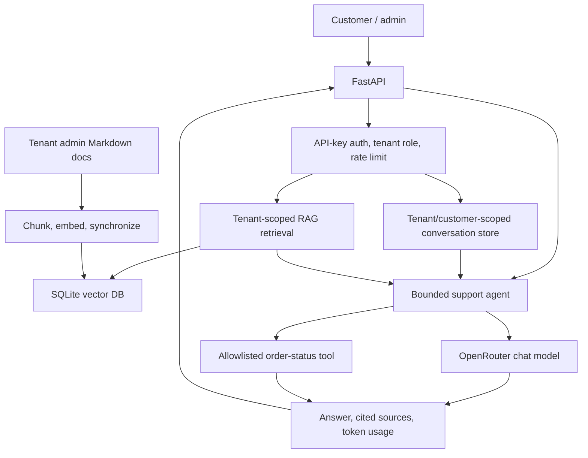

# Agentic Customer Support

A Python portfolio project for a grounded customer-support agent. It builds on the existing tool-calling, evaluation, and FastEmbed/SQLite RAG components with a FastAPI backend, persistent conversations, tenant-scoped knowledge bases, API-key authorization, and a small browser dashboard.

> **Status:** Working local prototype — not production-ready. The order lookup uses in-memory demo data, customer API keys bind requests to tenant and customer IDs, and the dashboard is intentionally lightweight.

## Features

- **Grounded support agent:** Retrieves tenant knowledge-base chunks before answering, labels retrieved text as untrusted evidence, accepts only exact evidence sentences with citations, and returns cited source metadata.
- **Bounded tool calling:** Uses the configured OpenRouter model and a Pydantic-validated order-status tool. Tool execution is allowlisted and the agent stops after three model iterations.
- **RAG:** Heading-aware Markdown chunking, FastEmbed embeddings, a configurable cosine-similarity relevance threshold, and a persistent SQLite vector store. API tenants use separate vector databases.
- **RAG regression evaluation:** Golden queries measure source recall at *k*. An offline test suite uses fakes; a separate command evaluates the real embedding model and local vector database.
- **Support behavior evaluation:** `tests/golden_cases.json` defines behavioral cases; `src/evaluation_runner.py`, `src/evaluator.py`, `src/rules.py`, and `src/judge.py` provide evaluation helpers and an optional judge interface. These modules do not expose a standalone CLI command.
- **FastAPI backend:** Validated chat and support endpoints, request IDs, bounded request rates, upstream timeouts, and sanitized provider/database errors.
- **Tenant and conversation isolation:** SQLite conversation history is scoped by tenant and, for customer keys, by authenticated customer ID. Tenant admins can access conversation history tenant-wide. Tenant knowledge-base files and vectors are stored separately. Customer order lookups are scoped to the authenticated tenant and customer IDs.
- **Authentication and administration:** Random API keys are stored as SHA-256 digests, role checks protect admin routes, and new tenant keys are only returned once.
- **Conversation and knowledge-base dashboard:** A minimal browser UI for support chats, conversation browsing, and tenant knowledge-base management.
- **Token and cost tracking:** Provider usage is returned with chat responses and can be summarized by tenant when the provider reports usage.

## Architecture



Retrieved documents are serialized as untrusted evidence and the system prompt says not to follow instructions in them. This is defense-in-depth, not a guarantee against prompt injection. There are no write-capable business tools in the current registry.

## Repository layout

This is the reproducible project layout; local secrets, generated reports, virtual environments, caches, and runtime databases are intentionally omitted.

```text
agentic-customer-support/
├── .dockerignore
├── .env.example
├── .gitignore
├── Dockerfile
├── knowledge_base/
│   ├── faqs/
│   │   └── general.md
│   └── policies/
│       ├── returns.md
│       └── shipping.md
├── prompts/
│   └── support_v1.txt
├── pyproject.toml
├── README.md
├── scripts/
│   ├── __init__.py
│   ├── audit_vector_database.py
│   ├── evaluate_retrieval.py
│   ├── ingest_knowledge_base.py
│   └── test_real_retrieval.py
├── src/
│   ├── __init__.py
│   ├── agent.py
│   ├── app.py
│   ├── conversations.py
│   ├── evaluation_runner.py
│   ├── evaluator.py
│   ├── judge.py
│   ├── llm_client.py
│   ├── rate_limiter.py
│   ├── rules.py
│   ├── security.py
│   ├── tenant_services.py
│   ├── rag/
│   │   ├── __init__.py
│   │   ├── chunking.py
│   │   ├── context_builder.py
│   │   ├── embeddings.py
│   │   ├── evaluation.py
│   │   ├── ingestion.py
│   │   ├── retrieval.py
│   │   ├── similarity.py
│   │   └── vector_store.py
│   ├── schemas/
│   │   ├── __init__.py
│   │   └── support.py
│   └── tools/
│       ├── __init__.py
│       ├── order_tools.py
│       ├── registry.py
│       └── schemas.py
├── tests/
│   ├── __init__.py
│   ├── golden_cases.json
│   ├── rag_golden_cases.json
│   ├── test_agent.py
│   ├── test_app.py
│   ├── test_chunking.py
│   ├── test_context_builder.py
│   ├── test_conversations.py
│   ├── test_embeddings.py
│   ├── test_evaluation_runner.py
│   ├── test_evaluator.py
│   ├── test_ingestion.py
│   ├── test_judge.py
│   ├── test_llm_client.py
│   ├── test_order_tools.py
│   ├── test_rag_evaluation.py
│   ├── test_rate_limiter.py
│   ├── test_retrieval.py
│   ├── test_rules.py
│   ├── test_security.py
│   ├── test_similarity.py
│   ├── test_support_schema.py
│   ├── test_tenant_services.py
│   ├── test_tool_registry.py
│   └── test_vector_store.py
└── uv.lock
```

The checkout may also contain ignored local files that are not part of this layout, including `.env`, SQLite databases under `data/`, tenant vector stores, and local review reports. Do not commit these files. Runtime API-key, conversation, rate-limit, knowledge-base lock, and synchronization databases use `AGENTIC_DATA_DIR`; tenant vector stores and Markdown documents use the configured data and knowledge-base roots. The complete `/data/` directory, common SQLite database and sidecar filenames, and known tenant-store directories are ignored. If a custom project-relative `AGENTIC_KNOWLEDGE_BASE_DIR` uses another directory name, add its path to `.gitignore` or place it outside the repository. `data/vectors.db` is a local RAG evaluation store and must remain untracked.

## Requirements

- Python 3.12+
- [uv](https://docs.astral.sh/uv/)
- An OpenRouter API key and configured model for live agent requests

## Setup

Run commands from this project directory:

```bash
uv sync
```

Create a private `.env` from the placeholder file (`Copy-Item .env.example .env` in PowerShell, or `cp .env.example .env` in a POSIX shell). Set the OpenRouter variables:

```env
OPENROUTER_API_KEY=your_openrouter_api_key
OPENROUTER_MODEL=anthropic/claude-sonnet-4.6
```

The API requires at least one `platform_admin` API key at startup. Generate a high-entropy key:

```bash
uv run python -c "import secrets; print(secrets.token_urlsafe(32))"
```

Put the generated value in `.env` as JSON (replace the placeholder with the generated key):

```env
AGENTIC_API_KEYS_JSON='{"replace-with-generated-random-key":{"tenant_id":"platform","role":"platform_admin"},"replace-with-customer-key":{"tenant_id":"tenant-demo","role":"customer","customer_id":"customer-demo"}}'
```

Supported roles are `customer`, `tenant_admin`, and `platform_admin`. Customer keys require a non-empty `customer_id`; the platform-admin route for issuing customer keys requires `{"customer_id":"..."}`. The application stores API-key digests, not the original keys. Existing environment customer-key entries need a `customer_id` before upgrading. Previously stored customer keys without a customer identity cannot use customer chat or conversation endpoints and must be reissued. Environment-configured keys removed from `.env` are revoked on restart. Never commit `.env` or send API keys to a client-side repository.

The default relevance threshold is `0.6`; change it with `AGENTIC_RELEVANCE_THRESHOLD` after evaluating against your own labeled queries. The embedding model may need to download on its first use.

### Configuration reference

These are the environment variables read by the application:

| Variable | Required | Default / purpose |
|---|---|---|
| `OPENROUTER_API_KEY` | For live model requests | OpenRouter credential. Keep private; do not include it in logs or source control. |
| `OPENROUTER_MODEL` | For live model requests | Model identifier; the example value is shown above. |
| `AGENTIC_API_KEYS_JSON` | At startup | JSON mapping of API keys to principals; at least one active `platform_admin` key is required. |
| `AGENTIC_DATA_DIR` | No | `data`; stores application SQLite databases and per-tenant vector stores. |
| `AGENTIC_KNOWLEDGE_BASE_DIR` | No | `data/tenant_knowledge_bases`; runtime root for tenant Markdown documents, created as documents are written. |
| `AGENTIC_RATE_LIMIT_REQUESTS` | No | `60` requests per tenant in the configured time window. |
| `AGENTIC_RATE_LIMIT_WINDOW_SECONDS` | No | `60` seconds. |
| `AGENTIC_RATE_LIMIT_REDIS_URL` | No | Unset uses SQLite-backed rate limiting; set a Redis URL for shared multi-host limits. |
| `AGENTIC_RELEVANCE_THRESHOLD` | No | `0.6`, cosine-similarity relevance threshold; accepted range is `-1` to `1`. |

## Run the application

```bash
uv run uvicorn src.app:app --host 127.0.0.1 --port 8000
```

Open the prototype dashboard at <http://127.0.0.1:8000/dashboard>. `GET /health` is unauthenticated; application and admin APIs require `X-API-Key`.

## Current verification

### Automated checks

The full suite was run during this README audit:

- `uv run pytest -q` — **191 passed in 10.17s**.
- The suite mocks LLM and embedding providers where appropriate; it does not verify live OpenRouter availability.
- The RAG evaluation script and Docker build were not run during this audit. Docker requires a running daemon. Ingestion changes the local vector database, so back up existing runtime data or configure an isolated data directory before running ingestion.
- Earlier local manual checks reported startup, health, API-key authentication, and authenticated conversation access as verified. They were not repeated during this audit.
- The last reported live support request returned HTTP 502. Its provider-side root cause remains unconfirmed; the current generic OpenRouter error log includes request ID, error class, and upstream status without logging provider response content or credentials. A mocked `/api/v1/support` success/error path is covered by the test suite.

### Main API routes

| Route | Access | Purpose |
|---|---|---|
| `POST /api/v1/chat` | Any configured tenant role | Send a chat message; optionally continue a conversation with its UUID |
| `POST /api/v1/support` | Any configured tenant role | Support-oriented chat response with cited source metadata |
| `GET /api/v1/conversations` | Any tenant role; customers see their own only | List conversations |
| `GET /api/v1/conversations/{conversation_id}` | Any tenant role; customers see their own only | Read a conversation |
| `DELETE /api/v1/conversations/{conversation_id}` | Any tenant role; customers delete their own only | Delete a conversation |
| `GET /api/v1/knowledge-base` | Tenant or platform admin | List the tenant's Markdown documents |
| `PUT /api/v1/knowledge-base/{document_name}` | Tenant or platform admin | Create/update a Markdown document and re-index its tenant knowledge base |
| `DELETE /api/v1/knowledge-base/{document_name}` | Tenant or platform admin | Delete a document and synchronize its tenant index |
| `GET /api/v1/admin/usage` | Tenant or platform admin | Summarize the tenant's reported tokens and cost |
| `GET /api/v1/admin/tenants` | Platform admin | List tenants |
| `POST /api/v1/admin/tenants` | Platform admin | Create a tenant and issue its tenant-admin key |
| `GET /api/v1/admin/tenants/{tenant_id}/keys` | Platform admin | List key metadata for a tenant |
| `POST /api/v1/admin/tenants/{tenant_id}/keys` | Platform admin | Issue a customer key for a `customer_id` |
| `GET /api/v1/admin/tenants/{tenant_id}/usage` | Platform admin | Read usage for a selected tenant |
| `DELETE /api/v1/admin/keys/{key_id}` | Platform admin | Revoke an API key |

`GET /health` and `GET /dashboard` are unauthenticated. All `/api/v1/` routes require a valid `X-API-Key`; role requirements are listed above.

Chat request bodies accept a non-empty `message` up to 4,000 characters and an optional UUID `conversation_id`. Responses contain `message`, `sources`, `usage`, and `conversation_id`. OpenRouter cost is reported as `null` when the provider omits it.

To create a tenant, use `POST /api/v1/admin/tenants` with a platform-admin key. The response includes a new tenant-admin API key; save it securely because it is not shown again. Issue customer keys with `POST /api/v1/admin/tenants/{tenant_id}/keys` and a JSON `customer_id`; each key is bound to that customer. Tenant admins can then upload Markdown through the knowledge-base routes or dashboard. Conversation and knowledge-base queries use the authenticated tenant, not a client-supplied tenant ID; customer conversation queries are additionally scoped to the authenticated customer.

## Run tests and RAG evaluation

```bash
uv run pytest -q
```

Tests mock the LLM and embedding services where appropriate; no OpenRouter key is needed. The real retrieval evaluation uses the local embedding model and the existing shared `data/vectors.db`:

```bash
uv run python -m scripts.ingest_knowledge_base
uv run python -m scripts.evaluate_retrieval
```

`scripts.ingest_knowledge_base` updates the local vector database; preserve or back up existing runtime data before running it. The golden set contains three queries and is a small regression baseline, not a production-quality retrieval benchmark. Expand it with representative, labeled customer questions before relying on its scores. `scripts/test_real_retrieval.py` prints retrieved document text, and `scripts/audit_vector_database.py` can print stored chunk text; do not capture their output in shared logs if it may contain private knowledge-base content.

## Docker

Build and run locally:

```bash
docker build -t agentic-customer-support .
docker run --rm -p 8000:8000 --env-file .env -v agentic-data:/app/data agentic-customer-support
```

The image runs as a non-root user and does not copy `.env` or runtime data into the image. The Python base image and `uv` builder image are pinned by digest; update those digests deliberately. Keep the data volume persistent. Configure TLS at a trusted reverse proxy before exposing the service outside a local development environment.

## Important limitations before production use

- Tenant admins can access all conversations in their tenant; customer API keys are restricted to conversations owned by their authenticated customer ID. Legacy conversations without a recorded customer owner remain available to tenant admins but are not exposed to customers. Customer API key distribution and rotation are still the application's responsibility.
- The order lookup is sample, in-memory data. It filters by authenticated tenant and customer IDs but is not connected to an authoritative order system.
- SQLite data is not encrypted at rest. Tenant databases are separate files, but backups and filesystem permissions still need operational protection.
- The sliding-window rate limiter uses SQLite and is shared by workers and restarts using the same persistent local `AGENTIC_DATA_DIR`. Multi-host replicas need a distributed limiter such as Redis; do not put SQLite on an arbitrary network filesystem.
- Set `AGENTIC_RATE_LIMIT_REDIS_URL` to use the atomic Redis limiter across hosts. Redis is pinged at startup and requests fail closed with 503 if the limiter backend becomes unavailable.
- Knowledge-base mutations are serialized through a SQLite lock and recorded in a sync journal. Keep `AGENTIC_DATA_DIR` and `AGENTIC_KNOWLEDGE_BASE_DIR` on persistent storage shared by workers on the same host so interrupted indexing can be reconciled before the next retrieval.
- Logs include request IDs and timing metadata, but there is no distributed tracing or metrics backend.
- The API key configuration requires a platform-admin key at startup. Tenant deletion is intentionally not exposed; provisioning and data-retention policies need operational review.
- Retrieved answers with sources must quote exact evidence text and cite it; paraphrases fail closed. This does not prove that the knowledge base itself is trustworthy. Add adversarial live-model evaluations and a full threat model before connecting real business tools or customer data.
- The Docker image and app are deployment-prepared, not deployed. No deployment credentials or infrastructure are included.

## Local files excluded from release

The local checkout may contain `.env`, `data/` SQLite databases and tenant vector stores, and `project_code_review.txt` / `project_structure.txt`. These are ignored and are not part of the repository layout above. `project_audit.txt` is also covered by `.gitignore` when present. Keep `.env.example` as the trackable placeholder file; never replace it with real credentials.

## Author

**Ali Arslan Khan** · [GitHub](https://github.com/ali3dev)
