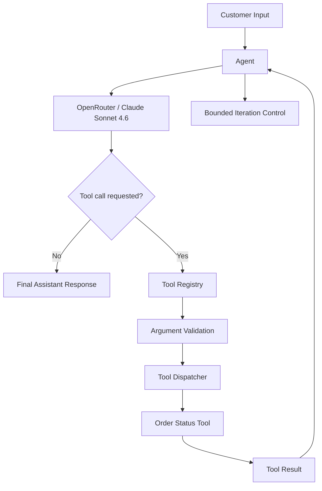
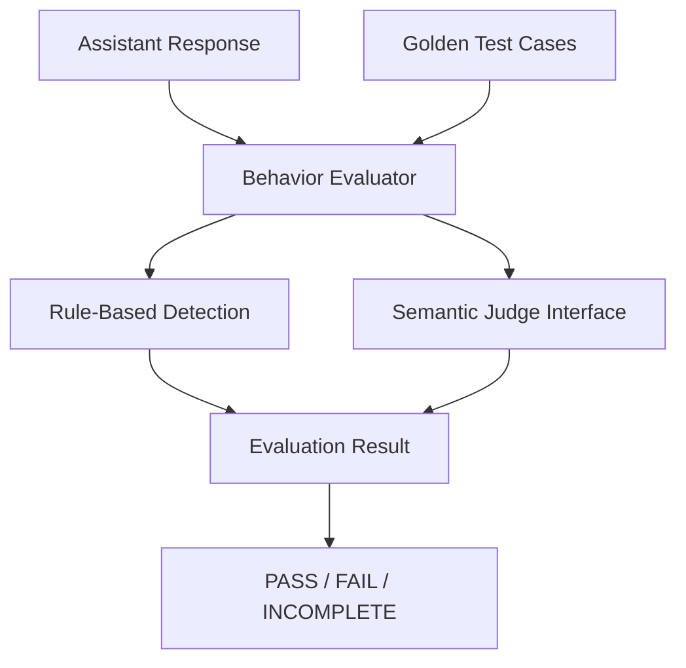

# Agentic Customer Support — LLM Evaluation & Tool-Calling Foundation

A Python-based Agentic AI engineering project exploring prompt engineering, structured output validation, behavior evaluation, LLM integration, and tool/function calling.

This project evolves incrementally through engineering milestones, focusing on reliable AI behavior, validated tool execution, bounded agent loops, and automated testing.

> **Project status:** Module 3 learning milestone — Tool & Function Calling. The project now includes a live OpenRouter integration using Claude Sonnet 4.6 and a working LLM tool-calling loop. It is an evolving Grand Project, not yet a production-ready autonomous customer support system.

## 1. Problem Statement

Customer support AI systems must provide helpful responses while avoiding unsupported claims and unauthorized actions.

For example, an assistant should not:
- Claim a refund has been approved without authorization.
- Invent refund policies or delivery dates.
- Treat unverified customer statements as confirmed company policy.
- Pretend to have access to tracking information when it does not.
- Execute tools with unvalidated or unauthorized arguments.

The purpose of this project is to explore how to build, validate, evaluate, and extend reliable AI application components.

## 2. Current Features

### Prompt Engineering & Evaluation
- Customer support prompt with explicit instructions and safety constraints.
- Pydantic structured output validation.
- Strict Boolean validation using `StrictBool`.
- Rule-based behavior detection.
- Pluggable semantic judge interface.
- Evaluation pipeline with PASS, FAIL, and INCOMPLETE outcomes.
- JSON-based golden test cases.

### LLM Integration
- OpenRouter API integration.
- Claude Sonnet 4.6 model configuration.
- Environment-based API key management.
- Configurable model request and tool definitions.

### Tool & Function Calling
- Pydantic-based tool input schemas.
- JSON Schema generation from Pydantic models.
- Central tool registry.
- Tool dispatcher with argument validation.
- Customer order-status lookup tool.
- Structured tool results for expected business outcomes.
- LLM tool-call and result-handling cycle.
- Bounded agent iterations to prevent unending loops.

### Testing
- Automated pytest suite.
- Mocked LLM responses for agent-loop tests.
- Tool execution and validation tests.
- Regression tests for existing evaluation components.

## 3. Current Architecture



The project also retains its separate evaluation foundation:



**Important:** The tool-calling loop is implemented and has been tested with a live model. The order data is currently in memory. The semantic judge remains an interface rather than a production LLM judge.

## 4. Project Structure

```text
agentic-customer-support/
├── prompts/
│   └── support_v1.txt
├── src/
│   ├── __init__.py
│   ├── rules.py
│   ├── evaluator.py
│   ├── judge.py
│   ├── evaluation_runner.py
│   ├── llm_client.py
│   ├── agent.py
│   ├── schemas/
│   │   └── support.py
│   └── tools/
│       ├── __init__.py
│       ├── schemas.py
│       ├── order_tools.py
│       └── registry.py
├── tests/
│   ├── golden_cases.json
│   ├── test_rules.py
│   ├── test_evaluator.py
│   ├── test_judge.py
│   ├── test_evaluation_runner.py
│   ├── test_support_schema.py
│   ├── test_agent.py
│   ├── test_order_tools.py
│   └── test_tool_registry.py
├── .env.example
├── .gitignore
├── pyproject.toml
├── uv.lock
└── README.md
```

## 5. Tool-Calling Workflow

The agent follows this cycle:

1. Receive a customer message.
2. Send the conversation and available tool definitions to the LLM.
3. Receive either a normal assistant response or a tool-call request.
4. Parse the tool arguments.
5. Validate arguments through the tool's Pydantic schema.
6. Dispatch the requested Python function.
7. Return the tool result to the model.
8. Allow the model to produce its final response.
9. Stop when the model finishes or the iteration limit is reached.

The model requests tool execution; the Python application actually executes the function.

## 6. Technology Stack

- Python 3.12+
- OpenRouter
- Claude Sonnet 4.6
- OpenRouter Python SDK
- Pydantic 2
- Pytest
- uv
- python-dotenv
- JSON and JSON Schema
- Python Protocols and dataclasses
- Regular expressions

## 7. Getting Started

### Prerequisites

- Python 3.12 or newer
- uv package manager
- Git
- OpenRouter API key for live LLM requests

### Clone the repository

```bash
git clone https://github.com/ali3dev/agentic-customer-support.git
cd agentic-customer-support
```

### Install dependencies

```bash
uv sync
```

### Configure environment variables

Create a local `.env` file using `.env.example` as a template.

```env
OPENROUTER_API_KEY=your_actual_api_key
OPENROUTER_MODEL=anthropic/claude-sonnet-4.6
```

Never commit your real `.env` file or expose your API key.

### Run the automated tests

```bash
uv run pytest -q
```

**Latest recorded result:** 38 tests passed.

The automated test suite uses mocks for LLM-dependent tests, so an API key is not required to run the tests. A valid OpenRouter API key and available model credits are required for live model requests.

### Run the agent

```bash
uv run python -c "from src.agent import run_agent; print(run_agent('Where is my order ORD-1001?'))"
```

The current demo includes sample order IDs such as `ORD-1001`, `ORD-1002`, and `ORD-1003`.

## 8. Engineering Decisions

### Strict structured output

Pydantic validates structured response data. `StrictBool` prevents strings such as `"false"` from being silently accepted as Boolean values.

### Separation of concerns

Tool schemas, Python tool implementations, registry, dispatcher, and LLM client are separate components.

This makes the system easier to test and extend.

### Validation at the execution boundary

Tool arguments are validated before execution. The model is not trusted to provide valid arguments simply because it generated a structured tool call.

### Explicit business outcomes

Expected outcomes such as an unknown order are returned as structured data rather than being confused with unexpected programming errors.

### Bounded agent execution

The agent uses an iteration limit to prevent uncontrolled tool-calling loops.

### Testable architecture

Core logic is tested independently. Mocked model responses allow agent-loop behavior to be tested without depending on live API calls.

## 9. Current Limitations

The project is an engineering learning foundation, not a production deployment.

Not yet implemented:

- Persistent production database.
- Customer authentication and authorization.
- Write-capable tools and approval workflows.
- Production semantic judge.
- Advanced retries, timeouts, and rate-limit management.
- Comprehensive malformed-response recovery.
- Structured tracing and observability.
- Detailed token and cost monitoring.
- Prompt-injection defenses and production threat modeling.
- Docker-based deployment and production infrastructure.
- Production evaluation benchmarks.

## 10. Project Roadmap

- [x] Prompt engineering foundation.
- [x] Structured output validation.
- [x] Rule-based behavior detection.
- [x] Pluggable semantic judge contract.
- [x] Evaluation pipeline and automated tests.
- [x] OpenRouter LLM integration.
- [x] Pydantic-based tool schemas.
- [x] Tool registry and dispatcher.
- [x] Customer order-status tool.
- [x] LLM tool-calling loop.
- [x] Bounded agent iterations.
- [x] Automated agent and tool tests.
- [ ] Production semantic evaluation.
- [ ] Retrieval-Augmented Generation (RAG).
- [ ] Persistent memory and conversation state.
- [ ] Advanced agent orchestration.
- [ ] Evaluation benchmarks and observability.
- [ ] Security hardening and deployment.

## 11. Learning Objectives

This project demonstrates practical exploration of:

- Prompt engineering as an engineering discipline.
- Structured output and boundary validation.
- Rule-based and semantic evaluation strategies.
- Python interfaces and separation of concerns.
- LLM API integration.
- Tool definitions and JSON Schema.
- Tool dispatch and execution.
- Model-driven tool selection.
- Agent call/result loops.
- Automated testing of AI application components.
- Reliability through bounded execution.

## 12. Author

**Ali Arslan Khan**

GitHub: https://github.com/ali3dev

This repository is part of an ongoing Agentic AI Engineering learning journey, focused on building reliable, testable, and production-oriented AI applications.

---

*Built incrementally through hands-on engineering, testing, and continuous improvement.*